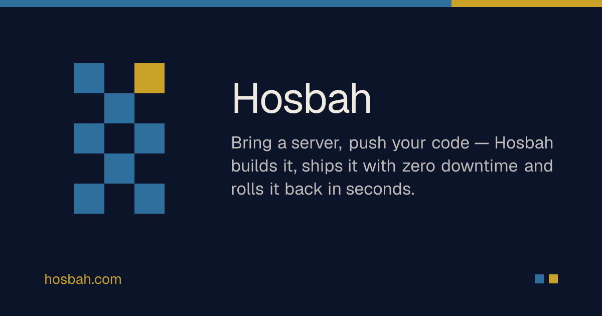

<div align="center">



# Hosbah — حوسبة

**Open-source server management and app hosting: connect your servers or Proxmox, deploy Go, Python, Node and PHP apps with zero downtime, and run databases, backups and tunnels from one control plane that you, your team and your AI agents share.**

[](https://to-go.dev)
[](https://github.com/togo-framework/togo)
[](https://github.com/fadymondy/hosbah/actions/workflows/ci.yml)
[](LICENSE)
[](https://github.com/fadymondy/hosbah/stargazers)

[Website](https://hosbah.com) · [Architecture](docs/architecture.md) · [Discussions](https://github.com/fadymondy/hosbah/discussions) · [Issues](https://github.com/fadymondy/hosbah/issues)

</div>

## Features

- **Bring any server** — paste a one-line install on a Linux box, or connect over SSH once. Ubuntu,
  Debian and the RHEL family are supported; Hosbah detects plain Linux, Docker and Proxmox VE.
- **A small, signed agent** — a static Go binary that dials out to the control plane, so servers
  need no open ports. Every operation is typed and ed25519-signed; the agent refuses anything
  tampered, expired or unknown, and updates itself from a checksummed release.
- **Proxmox** — create VMs from cloud-init templates or unprivileged LXC containers and have the
  agent installed automatically.
- **One-click deploys** — point at a git repository: it builds with your `Dockerfile` or with
  Railpack, runs the release step, health-gates the new version, then switches Caddy over with zero
  downtime. Rollbacks reuse the last five images. Optional `hosbah.toml` for ports, health checks
  and worker processes.
- **Ready apps** — one-click recipes for WordPress, Laravel, n8n, Odoo, MinIO, Mailpit,
  Uptime Kuma, SearXNG and more.
- **Databases, buckets and backups** — managed Postgres, MySQL, Redis and MongoDB services and
  S3-compatible MinIO buckets, attached to apps as env vars, with restic backups and restore tests.
- **Tunnels** — publish servers behind NAT through frp or join them to a Tailscale tailnet.
- **Teams and security first** — teams with owner/admin/deployer/viewer roles, default-deny routes,
  Postgres row-level security on every tenant table, per-team envelope encryption, TOTP 2FA and an
  audit log.
- **AI agents over MCP** — a team MCP server (and OAuth 2.1 connectors) so Claude, ChatGPT and
  friends can provision, deploy and read logs under the same permission checks as a person.
- **SDKs and CLI** — Go, Node, Python and PHP/Laravel SDKs and a cross-platform `hosbah` CLI.
- **Bilingual** — English and Arabic (RTL), light and dark.

## Quick start

### Hosted

The fastest way to try Hosbah is the hosted version at **[hosbah.com](https://hosbah.com)**: sign up,
create a team and add your first server.

### Self-host with Docker Compose

Requirements: Docker with Compose v2.

```bash
git clone https://github.com/fadymondy/hosbah.git && cd hosbah
cp .env.selfhost.example .env.selfhost
# fill in POSTGRES_PASSWORD, HOSBAH_APP_DB_PASSWORD, AUTH_SECRET and HOSBAH_KEK
# (generate each with: openssl rand -base64 32) and back up HOSBAH_KEK
docker compose -f docker-compose.selfhost.yml --env-file .env.selfhost up -d --build
```

Open http://localhost:3710 and sign up. The stack is Postgres 16, a one-shot migration job, the Go
API (which also serves the agent binaries) and the Next.js web app. For a public deployment put a
TLS reverse proxy in front, set `APP_URL` to the public origin, `HOSBAH_AGENT_URL` to an origin your
servers can reach and `COOKIE_SECURE=1`. Every other setting (OAuth sign-in, GitHub App, Cloudflare
DNS, mail) is documented in [`.env.example`](.env.example).

Make yourself a platform admin (for `/admin` and the admin MCP server):

```bash
docker compose -f docker-compose.selfhost.yml --env-file .env.selfhost exec api /app/hosbah-admin promote you@example.com
```

### Local development

See [CONTRIBUTING.md](CONTRIBUTING.md#local-setup) and the "Run it" section of
[docs/architecture.md](docs/architecture.md#run-it).

## Architecture

```
  browser · mobile · CLI/SDKs · MCP clients
                     │  /api (proxied by web), /api/mcp
          ┌──────────▼───────────────────────────────────────────────┐
          │ Go control plane (ToGO: chi + Huma REST + sqlc + pgx)     │
          │  default-deny routes → tenancy.Tx (RLS) → teams, servers, │
          │  apps, deploys, data services, tunnels, MCP               │
          │  operations queue · ed25519 signer · envelope encryption  │
          └──────┬──────────────────────────────────▲────────────────┘
                 │ PostgreSQL 16 (FORCE RLS)        │ wss /agent/ws (agents dial out)
          ┌──────▼───────┐               ┌──────────┴──────────┐
          │   Postgres   │               │ hosbah-agent on each │
          └──────────────┘               │ server: Docker, Caddy│
                                         │ builds, backups, frpc│
                                         └─────────────────────┘
```

| Path | What |
|---|---|
| `cmd/api`, `cmd/migrate`, `cmd/admin` | Control plane, migration ledger, platform admin CLI |
| `cmd/agent`, `internal/agent` | The server agent |
| `internal/agentproto`, `internal/ops` | Typed, signed operations and the queue |
| `internal/api`, `internal/tenancy` | Team-scoped handlers, roles and row-level security |
| `internal/deploy`, `internal/dbsvc`, `internal/providers` | Deploy pipeline, data services and backups, Proxmox |
| `db/atlas/migrations` | Schema, RLS policies and the migration ledger |
| `web/` | Next.js app (en/ar), UI from [Nasaq](https://github.com/fadymondy/nasaq) |
| `apps/`, `sdk/`, `cmd/hosbah` | Desktop and mobile apps, SDKs, CLI |
| `catalog/recipes` | One-click app recipes |

The full engineering notebook — the agent protocol, the deploy pipeline, tenancy, MCP and migrations — is in **[docs/architecture.md](docs/architecture.md)**.

### Built on ToGO

Hosbah is built on **[ToGO](https://to-go.dev)** ([GitHub](https://github.com/togo-framework/togo)), the
open-source, API-first framework for Go + sqlc + Atlas + GraphQL/OpenAPI + Next.js with a
Laravel-style CLI. The kernel is small and everything else is a plugin; these are the pieces
Hosbah uses:

| ToGO piece | What it does in Hosbah |
|---|---|
| [Kernel](https://github.com/togo-framework/togo) | Config, the hook/event bus, the plugin registry and server bootstrap |
| [CLI](https://github.com/togo-framework/cli) | `togo generate` (sqlc → OpenAPI), Atlas migrations, `togo serve` |
| [auth](https://github.com/togo-framework/auth) | Sign-in, JWT sessions, roles and API tokens |
| [authz](https://github.com/togo-framework/authz) | Policies and abilities on top of roles |
| [audit](https://github.com/togo-framework/audit) | The activity log |
| [orm](https://github.com/togo-framework/orm) | Query building in the control-plane services |
| [validation](https://github.com/togo-framework/validation) | Laravel-style request validation |
| [queue · cache · storage · realtime · i18n](https://github.com/togo-framework) | Background jobs, caching, file storage, live updates and EN/AR |
| [db-postgres](https://github.com/togo-framework/db-postgres) | The Postgres driver |
| [faker](https://github.com/togo-framework/faker) | Factories and seed data for tests |

Want the same foundation for your own app? Run `go install github.com/togo-framework/cli@latest && togo new myapp`,
then read the [ToGO docs](https://to-go.dev/en/docs) and browse the [plugin marketplace](https://to-go.dev/marketplace).

## Documentation

- [Architecture and engineering notes](docs/architecture.md)
- [Integrations](docs/integrations.md) · [CircleXO integration](docs/circlexo.md)
- [SDKs and CLI](sdk/README.md)
- API reference: run the API and open `/docs` (OpenAPI)

## Contributing

Contributions are welcome — bug reports, docs, recipes and code. Read
[CONTRIBUTING.md](CONTRIBUTING.md) for setup, conventions and the DCO sign-off, then look for
[`good first issue`](https://github.com/fadymondy/hosbah/labels/good%20first%20issue). AI coding
agents should start with [AGENTS.md](AGENTS.md).

## Community

- [GitHub Discussions](https://github.com/fadymondy/hosbah/discussions) — questions, ideas, show and tell
- [Issues](https://github.com/fadymondy/hosbah/issues/new/choose) — bugs and feature requests
- Security reports: see [SECURITY.md](SECURITY.md)

Please follow the [Code of Conduct](CODE_OF_CONDUCT.md).

## Sponsor

Hosbah is built on **[ToGO](https://github.com/togo-framework/togo)**, the open-source Go + React
framework that powers this whole family of apps. The best way to support Hosbah is to **sponsor ToGO**:
every sponsorship goes into the framework and the apps built on it.

**[Sponsor ToGO →](https://to-go.dev/sponsor)**

<p>
  <a href="https://to-go.dev/sponsor"></a>
  <a href="https://github.com/sponsors/fadymondy"></a>
  <a href="https://buymeacoffee.com/fadymondy"></a>
</p>

## License

Copyright (C) 2026 Fady Mondy. Hosbah is free software licensed under the
[GNU Affero General Public License v3.0](LICENSE). If you run a modified version as a network
service, you must offer its source to your users. Third-party components keep their own licenses.

**Commercial licensing available:** for a license without the AGPL obligations, contact
[info@3x1.io](mailto:info@3x1.io).
